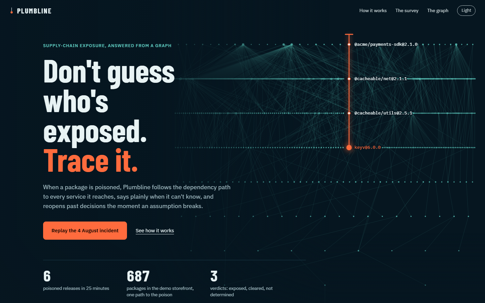
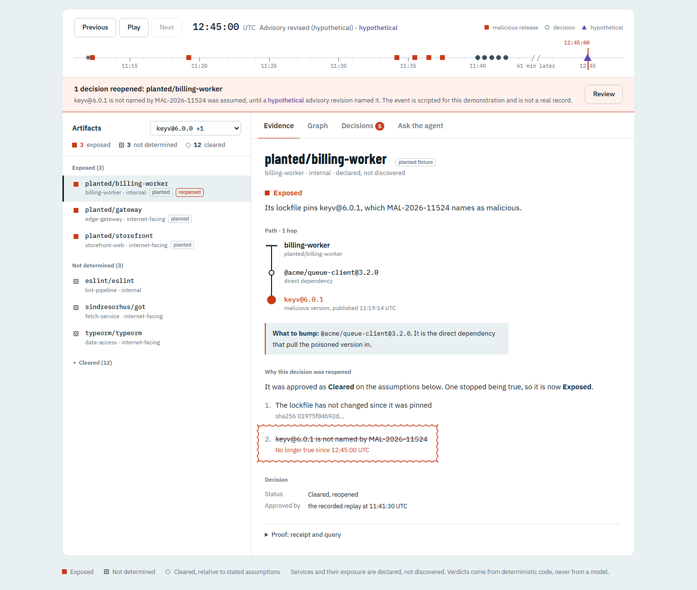

# Plumbline

An agent that answers "are we exposed?" for a software supply-chain incident with a FalkorDB path or an explicit
refusal, and remembers every accepted risk together with the assumptions it rests on. When a new fact breaks an
assumption, exactly the affected decisions reopen.

Built for [Graph Hacks: Context for AI Agents](https://www.wemakedevs.org/hackathons/falkordb) (Oct 15-18, 2026).

**Status:** the data pipeline, graph, verdict policy, receipts, decision memory, replay, MCP server and agent, web UI and Docker deployment all work and are tested. Tenants, an algorithm tool and an ablation are not built yet.

## The incident

The replay is a real event: on 2026-08-04 a compromised maintainer account published trojanized releases of `keyv`,
`cache-manager` and the `@cacheable/*` packages within 25 minutes (OSV `MAL-2026-11523`, `11524`, `11558` to `11561`).
Details and sources: [docs/incident.md](docs/incident.md).

The fleet is 14 public repositories pinned to their commit at the minute before the first malicious release, plus
three clearly labelled planted fixtures. Result so far: no real repository locked a malicious version, and `nestjs/nest`
sat one patch below one (`cache-manager@7.2.9` against malicious `7.2.10`).

## Verdicts

| Verdict | Meaning |
|---|---|
| EXPOSED | An artifact locks an affected version, with the evidence path |
| CLEARED | Valid only relative to stated assumptions, stored as `ASSUMES` edges |
| UNKNOWN | Evidence is missing (for example no lockfile); the agent refuses to guess |

Verdicts come only from deterministic, unit-tested code (`src/plumbline/policy`). The graph supplies the evidence: what each
artifact locks, what an advisory names, and the dependency path between them. A language model will select tools and
phrase answers; it can never produce or change a verdict.



The site opens on the real dependency tree of a 687-package service, with the poisoned path pinned to one vertical line, a plumb
line, and a bob at the malicious version. Below it, a plain explanation, then the survey itself:



A timeline drawn to time scale sits above a list of artifacts and a detail pane (Evidence, Graph, Decisions, Ask). The Graph tab
draws an artifact's whole dependency tree with hover-to-trace. When a decision reopens, a revision cloud marks the one assumption
that stopped being true. The page ends with the real Cypher and measured graph sizes. A dark theme follows the system setting.

## Try it

```bash
docker compose up -d && python -m plumbline load
python -m plumbline serve            # http://127.0.0.1:8000
```

Step through the incident with the timeline (or press play). The page also runs with no server from recorded snapshots;
see [docs/deploy.md](docs/deploy.md). The agent reaches the graph only through an MCP server (`python -m plumbline.agent.mcp_server`)
exposing eight read-only tools, including a fleet-wide fix-first query and PageRank. Approving a decision is a human action and is deliberately not a tool.

On a shared deployment each visitor has their own approval history (kept by a session cookie and replayed for that visitor
alone), approvals are limited to ten per hour per address, and `PLUMBLINE_APPROVALS=off` makes the site read-only.
Set `PLUMBLINE_TRUST_PROXY=1` when running behind a proxy that sets `X-Forwarded-For`, so limits count real clients.

## Graph data model

```
(Service)-[:RUNS]->(Artifact)-[:LOCKS]->(LockedDep)-[:REQUIRES]->(LockedDep)
(Service)-[:EXPOSED_VIA]->(Exposure)            (LockedDep)-[:IS]->(PackageVersion)<-[:AFFECTS]-(Advisory)
(Decision)-[:ABOUT]->(Advisory)   (Decision)-[:FOR]->(Artifact)   (Decision)-[:ASSUMES]->(Fact)   (Receipt)-[:PROVES]->(Decision)
```

Dependencies are modelled per artifact (`LockedDep`), so "which service reaches the poisoned version, and through what"
is one variable-length path query, not a join per hop. Decisions point at the facts they assumed, so a changed fact finds
every decision that rested on it. The full property lists, indexes and limits are in [docs/data-model.md](docs/data-model.md).

The queries the product depends on, all in `queries/`:

| Query | What it answers |
|---|---|
| `q1_exposure_base` | Which services lock a version an advisory names |
| `q2_explain_path` | The shortest dependency path from a service to the poisoned version |
| `q5_reopen_check` | Which accepted decisions assumed a fact that is no longer true |
| `q6_fix_first` | Which direct dependency to bump to clear the most exposure |
| `q7_critical_dependencies` | PageRank over the dependency graph: which packages the fleet leans on most |
| `tenant/*` | Per-upload graphs created with `GRAPH.COPY` from a template graph |

## Check your own lockfile

With the server running, open `/check.html` and paste a `package-lock.json` (npm lockfile v2 or v3). Each upload gets
its own FalkorDB graph, created from a template graph with `GRAPH.COPY`, so uploads cannot see each other or the
fleet graph. The upload is judged against the incident's advisories with the same policy, and the report shows the
dependency path, the direct dependency to bump, and the assumptions behind each verdict. Checks are deleted after 30
minutes; uploads are parsed, never installed or executed. It accepts an npm `package-lock.json` or `npm-shrinkwrap.json`
(`lockfileVersion` 2 or 3, up to 4 MB, 8,000 packages and 20,000 dependency links; three open checks per client); yarn, pnpm and v1 lockfiles are refused with a reason.
The page offers three samples (made by `scripts/make_check_samples.py`): a hand-authored exposed lockfile, a real unmodified
project that locks a safe `keyv` and is correctly cleared, and that real project with one version edited to the poisoned
release, which is correctly found through a four-package path. To cross-check a verdict against npm itself, put the
lockfile and a matching `package.json` in a folder and run `npm ls keyv --package-lock-only --offline`. The same flow is available as `POST /api/check`,
`GET /api/check/{id}`, `GET /api/check/{id}/graph` and `DELETE /api/check/{id}`. This needs the live server, so it is
not part of the static site.

## What it does from the terminal

```bash
# Who is exposed, with the dependency path, as of 11:40 UTC on the day of the incident?
python -m plumbline triage MAL-2026-11524 --at 2026-08-04T11:40:00Z --receipts data/raw/receipts

# Re-derive a receipt from the graph and check it (an edited receipt is rejected)
python -m plumbline verify data/raw/receipts/MAL-2026-11524__planted__gateway.json

# Replay approvals, then a clearly labelled scripted event; exactly one decision reopens
python -m plumbline replay --to 2026-08-04T13:00:00Z
```

Decisions record the facts they rest on. When one of those facts is contradicted, only the decisions that assumed it
reopen. See [docs/data-model.md](docs/data-model.md).

## Measured

The same lockfile questions are answered by the graph, by SQLite and by text retrieval, and graded against `npm ls`, which
shares nothing with this project's parser or graph (`python -m plumbline benchmark`, results in [docs/benchmark.md](docs/benchmark.md)).

| Question | Graph (FalkorDB) | SQL, tuned | Text retrieval |
|---|---|---|---|
| Does A lock P@V? (70) | 100% | 100% | 100% |
| Which direct dependencies pull P@V in? (16) | 100% | 100% | 44% |
| Which artifacts lock P@V? (7) | 100% | 100% | 86% |

A tuned in-process SQL query gets the same answers and is faster on lookups at this size. The graph's case is not speed: it is
evidence that carries its path, memory that knows what it assumed, algorithms such as PageRank, and a store several agents can
share. The benchmark also caught a real bug: peer dependencies were being treated as installs, which could name the wrong
package to bump. It is fixed and tested.

## Repository layout

```
docker-compose.yml     FalkorDB for local development (ports 6390 and 3010)
pyproject.toml         Python package and dev tooling
src/plumbline/
  ingest/              npm lockfile parser, fleet pinning, OSV advisories, processed JSONL builder
  graph/               connection, schema, loader
  policy/              deterministic verdicts (pure functions, no database)
  triage/              graph-backed evidence gathering, receipts
  memory/              decisions, assumptions, the replay
  agent/               typed tools, MCP server, built-in planner, optional model backend
  api/                 FastAPI app serving the UI and JSON
  snapshot.py          everything the UI needs for one moment; export_static.py writes them all
  cli.py               `python -m plumbline <command>`
web/                   Dependency-free UI (vanilla JS modules); web/data holds the static export
deploy/                Container entrypoint and the Hugging Face Space settings
Dockerfile             FalkorDB, API and UI in one unprivileged container
queries/               One named .cypher file per query; queries/load/ holds the loader statements
tests/                 Unit tests, plus integration tests that skip when FalkorDB is not running
data/
  incident.json        The chosen incident and its as-of time
  fleet.json           Pinned repositories with lockfile hashes
  replay.json          Recorded approvals and the labelled scripted event
  overlay.json         Declared (synthetic) service and exposure overlay
  fixtures/planted/    Hand-authored lockfiles
  processed/           Versioned, hashed JSONL that the graph loads from (committed)
  raw/                 Downloaded lockfiles, git-ignored and re-fetchable
docs/                  Verified engine behaviour, incident, data model
scripts/               probe_fleet.py, the tool used to choose the fleet
```

## Quick start

```bash
python -m venv .venv
.venv/Scripts/python -m pip install -e ".[dev]"      # on macOS/Linux: .venv/bin/python
cp .env.example .env
docker compose up -d                                  # FalkorDB on localhost:6390, browser on :3010

python -m plumbline load                              # rebuild the graph from data/processed
python -m plumbline query q1_exposure_base            # advisory x service exposure
python -m plumbline query q2_explain_path -p artifact=planted/gateway -p purl=pkg:npm/keyv@6.0.0
pytest
```

To regenerate the data from scratch (needs `git` and network access):

```bash
python -m plumbline pin-fleet     # pin repos to the incident time, download and hash lockfiles
python -m plumbline build-data    # fetch advisories, write data/processed/*.jsonl
```

## Documents

- [docs/falkordb-engine.md](docs/falkordb-engine.md): behaviour verified against the running engine
- [docs/incident.md](docs/incident.md): the real incident chosen for the replay
- [docs/data-model.md](docs/data-model.md): nodes, edges, indexes and known limits
- [docs/deploy.md](docs/deploy.md): GitHub Pages and Hugging Face Space deployment
